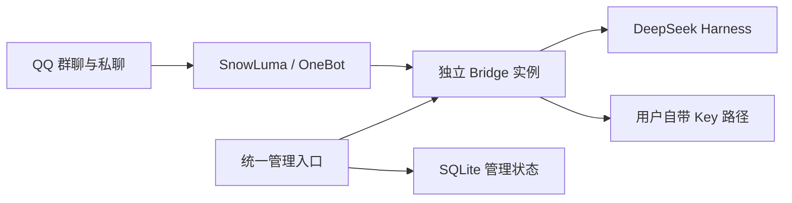

# QQ 机器人管理平台

基于 [Derpyu520/qq-bridge](https://github.com/Derpyu520/qq-bridge) 的管理扩展：一个入口管理多个 QQ AI 机器人，为群聊和私聊分别设置人设、保留可切换的会话、统计用量并控制每日费用。

**中文** · [English](README.en.md) · [项目交接](docs/HANDOFF.md) · [设计取舍与修正](docs/DESIGN_DECISIONS.md) · [开发步骤](docs/DEVELOPMENT.md) · [工作记录](docs/WORK_LOG.md)

**开发方向更新（2026-10-22）**：下一阶段基于 [QQ Agent fork](https://github.com/joodty/QQ-agent/tree/codex/group-management) 扩展公共机器人下的群管理与通用预算。本仓库的账号、权限、费用与测试成果作为迁移基础保留；现有部署和运行数据不因拉取新底座而切换。详见 [可复用功能与迁移边界](docs/guides/QQ_AGENT_MIGRATION.md)。

## 当前能力

- 群聊、私聊及管理员私聊可独立选择人设，未设置沿用全局。
- 人设会话档案支持 A → B → A 继续已有会话；不同对象上下文隔离。
- 按对象/日期统计估算费用；通常每日默认 ¥1，接近 80% 收敛，限额后暂停新付费调用。
- 平台管理员与普通账号分开；普通账号自助注册，密码登录与持久 Cookie，无网页令牌登录。
- 普通账号管理本人 Key、验证后的本人私聊、所属机器人和获授权的会话；Key 和资源归属不会提升平台角色。
- 多机器人实例身份、业务权限和费用来源隔离。平台安装登录服务后，用户提交申请即可在网页扫码接入独立 QQ，后台核验后启用，支持关闭继续和重新连接。
- SQLite 管理数据持久化；公共模型说明展示当前 26 张表、ER 与字段字典。

当前 Key 适配范围、存储边界、默认额度和未完成项见 [交接文档](docs/HANDOFF.md)。[网页 QQ 接入](docs/guides/WEB_QQ_LOGIN.md)需要平台先安装相应运行组件及内部服务；费用是估算，后端会话延续不保证供应商缓存永久存在。

## 换电脑后开始开发

Windows 先装 Git，在希望保存项目的目录打开 PowerShell，复制：

```powershell
git clone https://github.com/joodty/qq-bot.git
if ($LASTEXITCODE -ne 0) { throw 'Clone failed' }
Set-Location qq-bot
powershell -NoProfile -ExecutionPolicy Bypass -File .\scripts\local\Setup-Dev.ps1
if ($LASTEXITCODE -ne 0) { throw 'Development setup failed' }
```

脚本在项目目录准备经过 SHA256 校验的 Node 24、安装锁定依赖、运行隔离核心测试并启用推送前公开检查，不启动真实机器人。无需服务器或 API Key，不修改系统 Node。

已有 Node 24 的其他系统：

```bash
git clone https://github.com/joodty/qq-bot.git
cd qq-bot
npm ci --ignore-scripts --no-audit --no-fund
node scripts/patch-snowluma-sdk.mjs
npm run test:core
npm run check:public
```

将整个文件夹交给 Codex、WorkBuddy、其他 AI 或人工开发者，先读 `AGENTS.md` 和 [项目交接](docs/HANDOFF.md)。[详细开发说明](docs/DEVELOPMENT.md)包含继续已有克隆、假数据预览、浏览器测试、提交推送与真实运行的区别。

## 技术与界面



| 页面路径 | 用途 |
| --- | --- |
| `/login` | 账号密码登录 / 普通账号注册 |
| `/` | 平台控制台，或有权管理的独立机器人 |
| `/workspace` | 我的主页；费用、机器人、账号分别进入，手机提供底部导航 |
| `/viewer` | 聊天与人设：先选具体群聊或私聊，再编辑和应用 |
| `/bots` | 平台管理员的内部实例连接管理 |
| `/permissions` | 使用帮助：操作入口与可展开的权限说明 |
| `/data-model` | 无需登录的实际 ER、字段字典与目标模型讨论 |

普通账号的具体流程和手机布局见 [页面入口说明](docs/guides/MEMBER_NAVIGATION.md)。这些是应用路径，不是生产访问地址。真实运行需由实例所有者另外配置 OneBot、DSH 和凭据；开发夹具无需这些资料。

## 验证与公开边界

`npm run test:core` 使用临时状态和假 QQ/模型，不发送真实消息。`npm run test:audit` 保留完整历史审计；其中旧语音文档和本机 DSH 清单的环境依赖详见 [工作记录](docs/WORK_LOG.md)。

`npm run check:public` 检查公开文件；推送前钩子另查该分支的全部可达历史。生产配置、数据库、聊天、机器令牌、API Key、私钥和部署资料不在仓库。不要把原始私有快照分支或旧标签合并/推送到公开主线。

## 来源与许可

本项目以既有运行源码快照为基础继续开发，公开历史从脱敏版本开始，不包含上游完整 Git 历史。原项目与相关源码的 MIT 许可及署名保留在 [LICENSE](LICENSE)。与 QQ / SnowLuma / DSH 的边界见 [RULES.md](RULES.md) 和原有 [安全说明](docs/guides/SECURITY_BASELINE.md)；第三方服务和组件适用各自的许可与使用约定。
