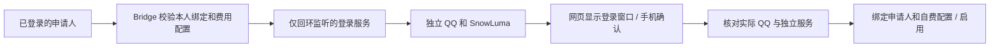

# 在网页扫码接入自己的 QQ 机器人

## 用户操作

1. 注册并登录，先完成主页的本人 QQ 验证。
2. 在“费用与额度 → 我的 API 密钥”添加自己的有效 DeepSeek 配置。
3. 打开“我的机器人 → 接入我自己的 QQ 机器人”，填写机器人 QQ、名称并选择自己的 API 配置，确认有权登录这个 QQ。
4. 提交后弹出扫码窗口。用准备作为机器人的手机 QQ 扫码，并在手机上确认。二维码过期可以刷新；关闭窗口后，在开通进度中点击“继续扫码”。
5. 系统核验实际在线 QQ、独立聊天服务及费用配置，再启用机器人。关闭窗口，在自有机器人列表进入“管理这台机器人”，添加允许聊天的群或好友。

未完成准备时，接入表单列出 QQ 绑定和 API 配置两项状态，提供直接跳转入口；没有可用配置时下拉框显示提示并禁用提交。数字账号名不代表已验证对应 QQ。页面内跳转准备步骤保留尚未提交的机器人名称和 QQ 草稿。这里的 API 配置包含已保存的 Key 和模型，每日聊天额度在接入后的机器人管理页设置。

本人 QQ 的身份绑定仍使用私聊 `/bind` 验证。这里的扫码用于登录一个由服务器运行的 QQ 客户端。它使用现有 SnowLuma/OneBot 接入方式，无需填写 QQ 开发者平台的 AppID/AppSecret；官方机器人 API 是另一种接入方式。

已接入的机器人可从开通进度点击“查看连接 / 重新扫码”。重新连接沿用已有实例、归属、当前费用来源、会话和角色配置。已经被平台转交其他账号的实例，原申请人无法再打开扫码窗口。

服务器名额或内存不足时显示具体原因，申请保留待重试状态。QQ 扫码与手机确认须由本人完成；显示二维码不代表已登录。已扫码的环境会继续身份核验，关闭窗口不会撤销接入。连接完成后的停用由机器人管理页处理。

## 实现边界

- 浏览器接口只接受申请 ID 和版本，按 Cookie 校验申请人。管理员查看申请进度不会获得他人的扫码图片。
- 内部服务的端口、机器凭据与配置路径只在服务器之间传递；网页不填写或取得这些资料。QR 图片是当前登录请求的敏感数据，不写 localStorage，不使用外部图片 URL，也不进入公共结构页面。
- 取图固定为所支持 QQ 镜像的 320 × 460 登录窗口。窗口尺寸不符、QQ 号码不符或已经识别到在线账号时，不用桌面或聊天窗口替代二维码。
- 登录服务给每个申请生成独立 QQ 数据目录、运行目录、SQLite、DSH home、消息状态和机器身份。共用只读程序及依赖，每个申请使用独立 OS UID/GID；名额回收后不复用旧申请的 OS 身份。
- 容器网络使用 `slirp4netns`，消息端口只转发到本机回环地址。该流程无需调整既有 Docker 网络、主机防火墙或 IP 转发。
- 申请和业务归属仍存在管理 SQLite 的现有文档/关系结构内，当前仍为 26 张表。独立登录服务另有服务器私有的名额与进程登记 JSON，保存运行凭据和目录对应关系，不替代账号、费用或会话数据库。
- 约两分钟后网页提示刷新；以原生 QQ 窗口的实际二维码有效性为准。未完成登录的环境约十分钟后停止，保留资料供重试。刷新不会无限延长一次未完成的开通环境。同一个已验证 QQ 的新环境创建存在短时冷却。
- 扫错 QQ 会停止该次接入；用户取消后重新申请。已接入实例的归属、版本或费用发生变化时，旧请求不能继续认领、覆盖或停用新所有者的机器人。

## 平台部署前提

开发测试不依赖 Docker、真实 QQ、模型密钥或服务器。真实接入另需平台安装 Linux 登录服务；未配置时网页保留原有人工准备申请流程，不显示可用的自助扫码入口。

当前运行适配以已验证的固定 SnowLuma/QQ 镜像为准：需要其 QQ 客户端、X11、`xwininfo`、`xwd`、Python 3 和 `libXtst`。镜像按完整 SHA256 固定；镜像内的启动脚本由平台按发行组件要求准备。本仓库提供接入程序，不分发第三方运行镜像或其修改版。相关组件适用各自许可。

1. 准备只读应用代码和 npm 依赖、独立安装的 DSH 包、Node 24、Docker 本地 socket、`slirp4netns`/`libslirp`、`setpriv`、`nsenter` 和 `ip`。共享程序目录需要能被工作实例的独立 UID 读取，不复制主实例的配置、账号库、QQ 数据、模型凭据或 DSH home。
2. 按 [配置示例](../../deploy/hosted-login.example.json) 创建服务器私有配置，替换所有示例路径、镜像和凭据。`root` 是新建的运行资料目录，必须与 `codeRoot` 分开。选择尚未占用的端口段和 UID/GID 起点；启用真实用户后保持身份起点不变。该配置设为 root 可读的 `0600`。
3. 按 [服务示例](../../deploy/qq-hosted-login.service.example) 安装独立 systemd 服务。登录服务仅监听 `127.0.0.1`；管理凭据使用随机 32 字节值。按实际容量调整名额、内存和 CPU 限制。示例默认一个额外机器人；每台机器人有实际 QQ/Node 内存开销。
4. 在主 Bridge 的私有 `state/bot-login-provider.json` 保存 `{"port":32109,"token":"example-use-the-same-private-broker-secret"}`，替换为实际服务端口与凭据。文件归主 Bridge 服务账号所有，权限 `0600`，不写进 Git。它不改变 `config.json` 中已有的登录或代理配置。
5. 重启目标 Bridge 以加载后端更新；登录服务和每台 QQ 实例独立运行。核验原账号、Cookie、角色、会话标识与其他服务，再用申请人本人完成扫码。

登录服务本身需要管理独立容器和切换工作实例 UID 的权限。对外开放的仍是原管理入口；内部登录监听、Docker socket、X11 和工作实例端口保持服务器内访问范围。容器只挂载本申请的 QQ 资料及已验证启动脚本。

## 验证

- `npm run test:hosted-login`：实际 SQLite、账号/租户服务与申请流程；覆盖精确归属、版本、Cookie 撤销、配置删除、自动启用、重连、取消并发、转交保护、内部通道与取图边界。
- `npm run test:hosted-login:ui`：真实 Bridge/SQLite 和 Chrome，登录服务与 worker 使用隔离 HTTP 夹具；覆盖未绑定/无 Key 的准备引导与草稿保留、自动弹窗、图像、过期刷新、关闭继续、提前关闭、手机、其他账号拒绝和成功后归属。
- `npm run test:core`：包含上述后端检查；其余账号、费用、会话与机器人隔离回归继续执行。

实际运行核验分为“新实例和二维码可用”“DSH/工作 Bridge 就绪”“本人扫码后真实 QQ 身份一致”三部分。没有本人扫码，不把前两部分的通过写成已经成功登录另一个真实 QQ。
